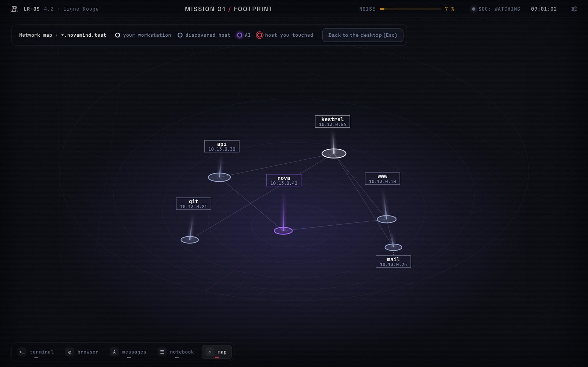

<p align="center">
  <picture>
    <source media="(prefers-color-scheme: dark)" srcset="docs/brand/breach-wordmark-dark-bg.svg">
    
  </picture>
</p>

# BREACH

A cybersecurity thriller in your browser. You are a junior pentester at Ligne Rouge, contracted to test NovaMind, a startup full of chatbots and AI agents. Attack, understand, then replay every step as the defender.

The game is available in English and French.

**Play it online: https://breach-game.github.io/breach/** (nothing to install, no account; your progress stays in your browser).

> **Nothing here is real.** The commands are simulated, the targets are fictional, and the game never sends a single packet to anyone. See [Everything is simulated](#everything-is-simulated).

<p align="center">
  <a href="https://breach-game.github.io/breach/"><b>▶ Play now</b></a> ·
  <a href="https://github.com/breach-game/packs">Community missions</a> ·
  <a href="https://github.com/breach-game/docs">Design docs</a> ·
  <a href="CONTRIBUTING.md">Contribute</a>
</p>

<p align="center">
  <a href="https://github.com/breach-game/breach/actions/workflows/ci.yml"></a>
  <a href="LICENSE"></a>
  
  
</p>


## The campaign

Ten missions, playable end to end in English and French: seven on the attacking side, then three where you defend. Each attack ends with a Blue Team debrief (how to defend against what you just did, the OWASP reference, the log of everything NovaMind's SOC saw of you) and a defence replay: find your own lines in the logs, pick the detection rule that would have caught you, then the fix, which the game checks by replaying your attack against it.

| # | Mission | You learn |
| --- | --- | --- |
| 0 | **The mandate** | Why a pentest starts with a signed contract and a scope |
| 1 | **Footprint** | Reconnaissance: DNS, network mapping, a secret forgotten in a git history (OWASP A05) |
| 2 | **The talkative intern** | Social engineering on a support chat (MITRE ATT&CK T1598) |
| 3 | **Nova knows too much** | Prompt injection and system prompt leakage (OWASP LLM01, LLM07) |
| 4 | **The trapped CV** | Indirect prompt injection in a document read by an AI (LLM01, LLM06) |
| 5 | **Too much power** | An AI agent with excessive agency (LLM06) |
| 6 | **On Mute's trail** | Incident response: retrace an intruder's path without changing anything (MITRE ATT&CK) |
| 7 | **Mute returns** | Blue Team: read the logs live and pick the narrowest containment before the data leaves |
| 8 | **Atlas under influence** | Blue Team: an AI agent obeys an impostor; stop it, then undo what it already did |
| 9 | **The partner's key** | Blue Team: a leaked API key, and why blocking one address is not enough |

Three guidance levels: **Guided** (Ada gives every command), **Standard** (Ada gives the direction) and **Expert** (briefing and objectives only). The more you play on your own, the higher the score multiplier. A mission is not only flags: some are won by repairing a configuration file (`verify` judges the result) or by answering a question from Ada. A flag only counts once the target has shown it to you.

## Beyond the campaign

| From the title screen | What it is |
| --- | --- |
| **Trainings** | Four short missions, one technique each, always open: reading a log, encoding is not encryption, an altered install script, a suspicious email |
| **Seasons** | Official series in new companies. Season 2 audits Halcyon's build chain: reconnaissance, dependency confusion, then the defence, with the 2021 research it comes from. Season 3 audits Pélican, an online shop, before its sales: the classic web flaws (what a site gives away, injection, stored markup and an assistant that repeats it, guessable sessions, business logic), each with its fix. Season 4 is played on the defender's side: a ransomware response at the town hall of Corbelle, where you contain the attack as it runs, advise the mayor (decisions with a price and consequences, no right answer), restore from the right backup, then write the detection rule and fix the backup plan. Season 5 audits Sélène, a platform that rents teams of AI agents: a document index shared between customers, a memory anyone can write to, a developer agent that invents package names, and an agent that takes another agent's name at its word. You finish by writing the guardrail yourself, and `eval run` judges it against forged and honest requests. Season 6 audits Alto, a start-up living entirely in one account of a fictional cloud provider: a backup bucket left public, a deployment token printed in a public build log, a role that allows everything, and an unknown application an employee authorised with one click, which you cut off on the defence side. Season 7 joins the bug bounty programme of the Lumière Noire festival: the programme rules are your mandate, a ticket can be transferred and then refunded, a report must be written without a single piece of real data before you decide when to publish, and on the eve of the opening you face a phishing wave from a look-alike domain on the defence side |
| **Community missions** | Packs from [breach-game/packs](https://github.com/breach-game/packs), checked and signed. Among them the *case files*: twelve short series, each inspired by a publicly documented incident (Codecov 2021, Twitter 2020, Uber 2022, Capital One 2019, xz Utils 2024, EchoLeak 2025 and others), played at a fictional company and closed by a sourced card of what really happened |
| **Replay a mission** | Any finished campaign mission again, at any guidance level, without touching your campaign score |

| | |
| --- | --- |
|  |  |
|  |  |

## Everything is simulated

The terminal looks and answers like the real tools, but it is a game engine written in TypeScript that runs entirely in your browser tab. There is no server behind it and no real shell.

- **The commands are imitations.** `nmap`, `curl`, `ssh`, `ping`, `dig`, `whois`, `git` and the others have no network code at all. Each one reads the fictional NovaMind world, loaded in memory from a data pack, and prints what the real tool would print. A "port scan" is a lookup in a table; its delay is a timer.
- **The targets do not exist.** Every host lives under `*.novamind.test` (a top-level domain reserved for testing, RFC 2606) or in the private range `10.13.0.0/16`. A pack that names a real-looking domain or a public address (apart from a few learning sites such as owasp.org, given as reading links) is refused when it is built and again when the game loads it.
- **The scope check is a game rule, not a safety net.** Aiming at an address outside the mandate (say `nmap 8.8.8.8`) gets a reminder from Ada about the law. Even if that check had a hole, the command would still only reach the simulated world: there is nothing that could send a real request.
- **The in-game browser draws pages itself.** It renders the world's pages from data. It loads no URL, follows no real link and has no iframe.
- **The vulnerabilities are classes, not exploits.** They illustrate OWASP Top 10 and OWASP LLM Top 10 categories. Nothing in the game works against a real system.

The only real requests the page ever makes:

| Request | Destination | When |
| --- | --- | --- |
| The game itself (HTML, scripts, fonts) | the site's own origin | on load |
| The mission packs (`packs/index.json`, `*.breachpack`) | the site's own origin | on load, then cached |
| Community missions (`index.json`, its signature, `*.breachpack`) | `breach-game.github.io/packs/` | only when you open *Community missions* |
| Model help for the characters | `api.anthropic.com` | only if you set your own API key and switch on a use |

The production Content Security Policy only allows those destinations, so the browser would block anything else.

## Model help for the characters (optional)

The whole game plays without any key: the characters follow a script. In the settings you can give your own Anthropic API key and choose what it is used for, each use with its own model and an estimate of what it costs:

- **Understand my messages**: a model recognises what you ask even when worded freely, in another language or with typos. It can only point at words the character already listens for, never a name or code word you have to find yourself.
- **Reword the replies**: a model says the line the script chose in its own words.

The script always decides what a character gives away, and flags are checked by the engine, so a mission plays out the same with or without a key. The key stays in your browser and calls go straight to `api.anthropic.com`. Apart from community missions you choose to open, it is the game's only outside connection, and it does not exist until a key is set. Details in [SECURITY.md](SECURITY.md).

## Development

Node 24+ (26 LTS recommended), pnpm 12.

```bash
pnpm install
pnpm dev          # builds the packs, then starts the game
pnpm test         # engine, commands, packs and mission solutions
pnpm packs:check  # validates the content
pnpm build        # static site in apps/game/dist
```

Going live: [docs/deploy.md](docs/deploy.md). GitHub Pages publishes the game after every merge to `main`; saves survive updates that do not touch the mission in progress. Security model and how to report a problem: [SECURITY.md](SECURITY.md).

| Folder | Role |
| --- | --- |
| `packages/engine` | deterministic engine, no DOM |
| `packages/pack-schema` | pack format and content safety checks |
| `packages/pack-cli` | pack validation and build |
| `apps/game` | LR-OS interface |
| `content/` | Official worlds (NovaMind, Halcyon, Pélican, Corbelle), campaign and season missions, trainings |
| `gateway/` | optional LLM gateway for free-form NPC dialogue (after v1) |

A mission is a declarative pack with no code. Official missions live in `content/` (see `CLAUDE.md`). Missions written by players live in [breach-game/packs](https://github.com/breach-game/packs), which has the guide for writing one; the game lists them under *Community missions*.

Design documents (game design, architecture, reviews, mockups) live in [breach-game/docs](https://github.com/breach-game/docs).

## Contributing

Bug reports, ideas and fixes are welcome: read [CONTRIBUTING.md](CONTRIBUTING.md) first. To write a mission, you need no code at all: see the [pack guide](https://github.com/breach-game/packs/blob/main/CONTRIBUTING.md). Everyone taking part follows the [Code of Conduct](https://github.com/breach-game/.github/blob/main/CODE_OF_CONDUCT.md). Security problems go through [private reporting](SECURITY.md), never a public issue.

## License

The code and the official missions are under the MIT licence, see [LICENSE](LICENSE). The fonts bundled through `@fontsource` (Space Grotesk, JetBrains Mono) are under the SIL Open Font License 1.1. The brand kit lives in [breach-game/.github](https://github.com/breach-game/.github/tree/main/brand), under CC BY 4.0.
