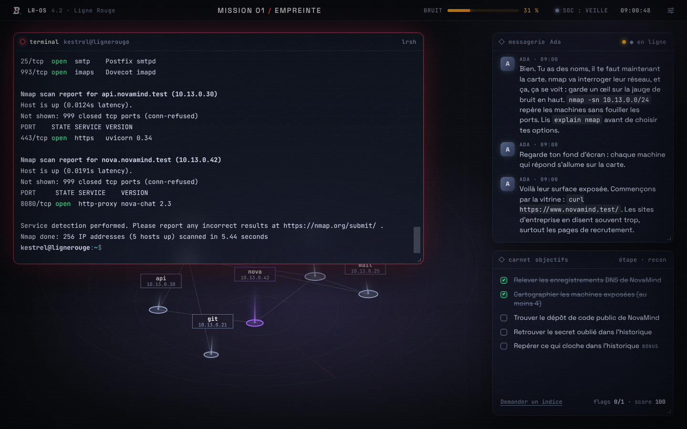

<p align="center">
  <picture>
    <source media="(prefers-color-scheme: dark)" srcset="docs/brand/breach-wordmark-dark-bg.svg">
    
  </picture>
</p>

# BREACH

A cybersecurity thriller in your browser. You are a junior pentester at Ligne Rouge, contracted to test NovaMind, a startup full of chatbots and AI agents. Attack, understand, then replay every step as the defender.

The game is available in English and French.

> All targets are fictional. The game never makes real network requests.

## Status

Lot 0: missions 0 ("The Mandate") and 1 ("Footprint") are playable end to end, in English and French. The v1 target is missions 0 to 3.



## Development

Node 22+, pnpm 10.

```bash
pnpm install
pnpm dev          # builds the packs, then starts the game
pnpm test         # engine, commands, packs and mission solutions
pnpm packs:check  # validates the content
pnpm build        # static site in apps/game/dist
```

| Folder | Role |
| --- | --- |
| `packages/engine` | deterministic engine, no DOM |
| `packages/pack-schema` | pack format and content safety checks |
| `packages/pack-cli` | pack validation and build |
| `apps/game` | LR-OS interface |
| `content/` | NovaMind world and missions |
| `gateway/` | optional LLM gateway for free-form NPC dialogue (after v1) |

A mission is a declarative pack with no code. To add one, see `CLAUDE.md`.

Design documents (game design, architecture, reviews, mockups) live in [breach-game/docs](https://github.com/breach-game/docs).

## License

MIT, see [LICENSE](LICENSE).
